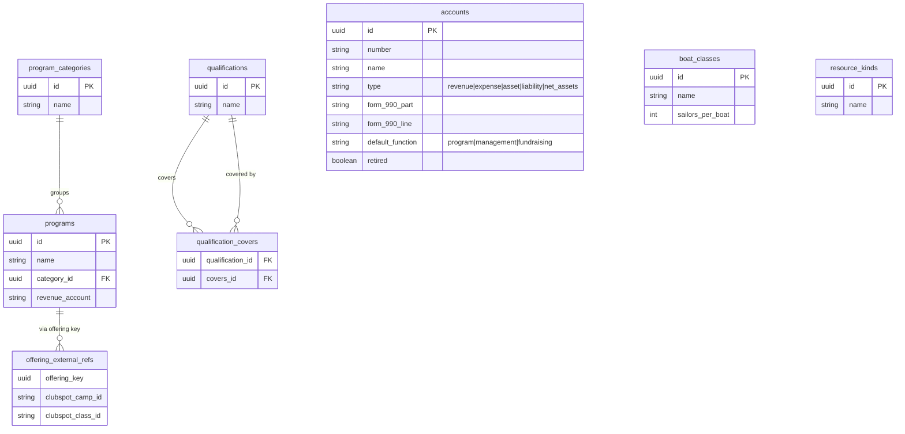
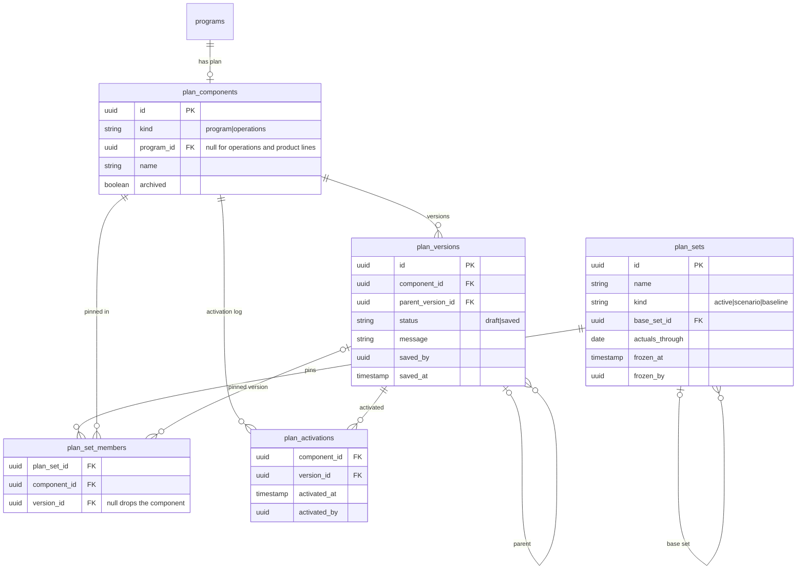
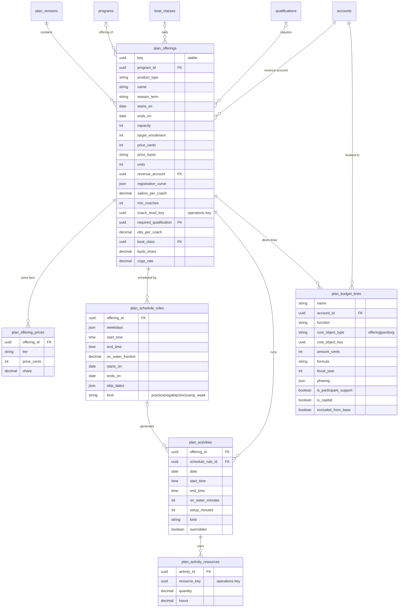
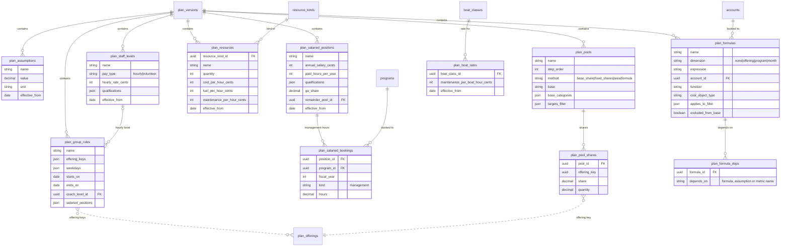
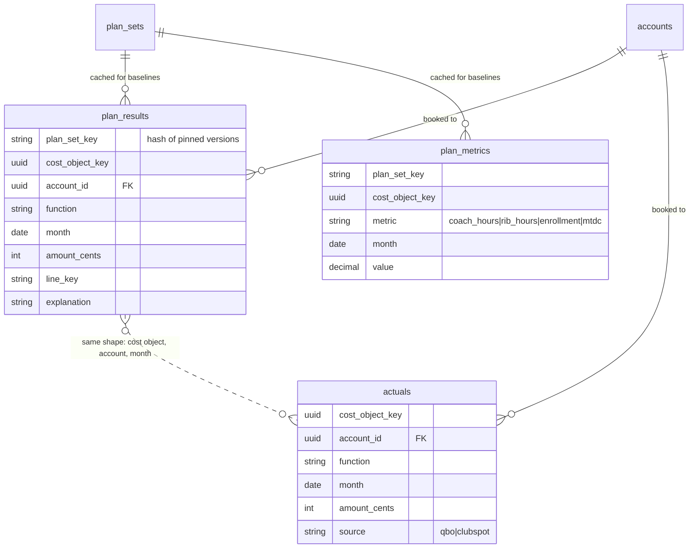

## Planning: schema

Entity-relationship diagrams for the program planning and financial model app. It is proposed and not built yet, so no `schema.yaml` declares these collections. Update the diagrams in the same change as any change to the planning design or to its collections.

### Terms

- **Program:** a lasting catalog entry, such as J-Pod Race Team. It moves from `crm` to a new `core` domain.
- **Offering:** something CYC sells for a period, such as Spring 2027 J-Pod. Charters, storage leases, merchandise and regatta hosting are offerings too.
- **Activity:** one dated, timed occurrence that consumes resources, such as a practice or a regatta day.
- **Group:** activities from different offerings that share coaches and boats, set up by the planner.
- **Cost object:** whatever a money line belongs to. That is an offering, a pool (G&A, program admin), or the org.
- **Component:** a separately versioned part of the plan. Each program has a program plan, and one operations plan holds what programs share.
- **Version:** a draft or an immutable saved snapshot of one component.
- **Plan set:** one version per component. The active set is "the plan". A scenario swaps versions, and a baseline is a frozen set that variance is measured against.

### Diagram conventions

Every version-scoped entity also has `id` (deterministic), `version_id` and `key`, which are left out of the diagrams below except where they matter. Arrays are shown as `json`. Dashed lines are references by stable `key` across components, which the engine resolves within a plan set rather than as database foreign keys.

### `core` catalog

### Versioning

### Program plan (one version)

### Operations plan (one version)

The operations plan also holds `plan_budget_lines` for org and pool lines (insurance, the clubhouse fee, fundraising, capital), with the same shape as the program plan's.

### Results and actuals

