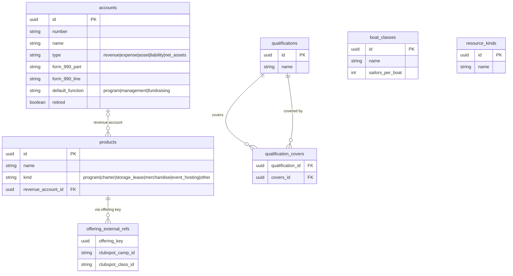
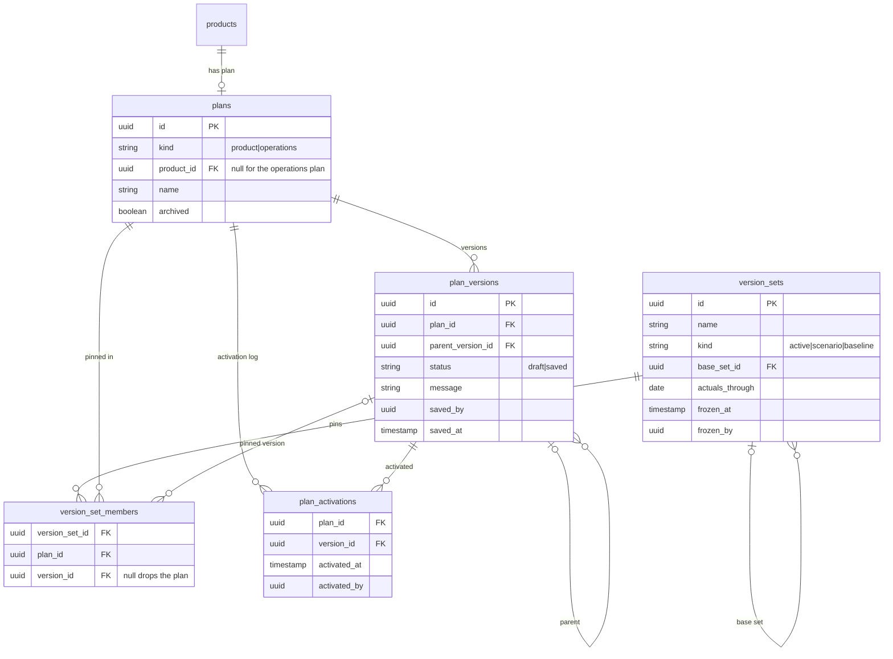
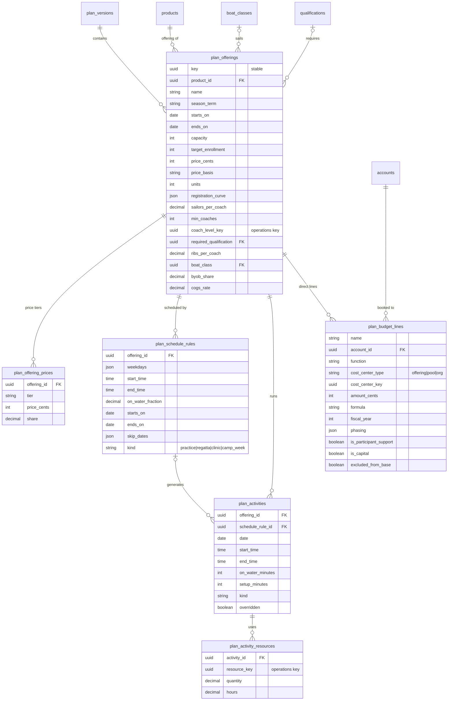
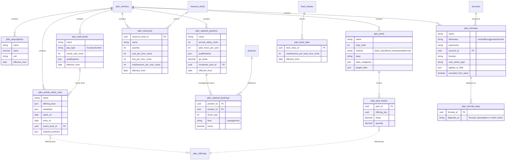
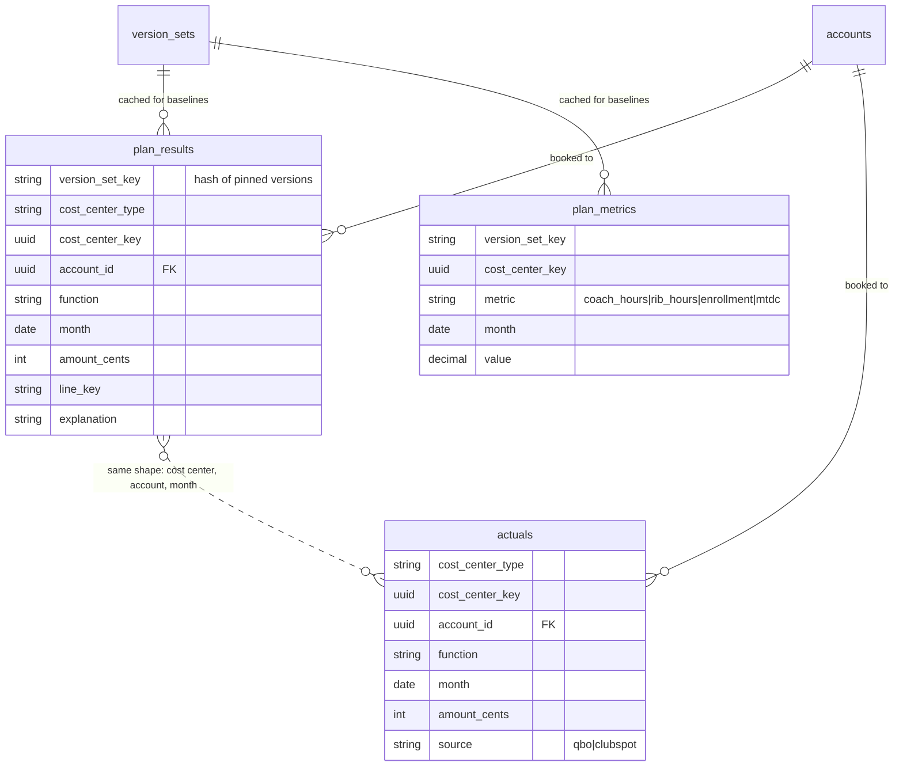

## Planning: schema

Entity-relationship diagrams for the program planning and financial model app. The app is proposed and not built yet, so no `schema.yaml` declares these collections. Update the diagrams in the same change as any change to the planning design or to its collections.

### Terms

- **Product:** a lasting thing CYC sells, such as J-Pod Race Team, boat charters or storage leasing. Products live in the new `core` domain.
- **Program:** a product of kind `program`, such as J-Pod Race Team. Each application groups programs its own way: the website by category, finance by revenue account, Google Workspace by Group. So no single program hierarchy exists.
- **Offering:** a product sold for a period, such as J-Pod Spring 2027, or charters for summer 2027.
- **Activity:** one dated, timed event that consumes resources, such as a practice or a regatta day.
- **Activity block:** activities from different offerings that share coaches and boats, set up by the planner. For example, J-Pod and K-Pod on Wednesdays.
- **Cost center:** what a money line belongs to. That is an offering, a pool (G&A, program admin), or the org. Offerings that earn revenue are strictly profit centers, but one field covers all three kinds.
- **Plan:** a separately versioned part of the plan. A **Program Plan** (or a Charter Plan, a Storage Plan and so on) holds one product's offerings. The **Operations Plan** holds what products share.
- **Version:** either a draft or an immutable saved snapshot of one plan.
- **Version set:** one version per plan.
  - The **active version set** is "the plan".
  - A **scenario** is a version set with some versions swapped, added or dropped.
  - A **baseline** is a frozen version set that variance is measured against.

### Diagram conventions

Every version-scoped entity also has an `id` (deterministic), a `version_id` and a `key`. The diagrams below leave these out except where they matter.

Arrays are shown as `json`.

Dashed lines are references by stable `key` across plans. The engine resolves them within a version set; they are not database foreign keys.

### `core` catalog

### Versioning

### Product plan (one version)

### Operations plan (one version)

The Operations Plan also holds `plan_budget_lines` for org and pool lines (insurance, the clubhouse fee, fundraising, capital). They have the same shape as the product plan's lines.

### Results and actuals

