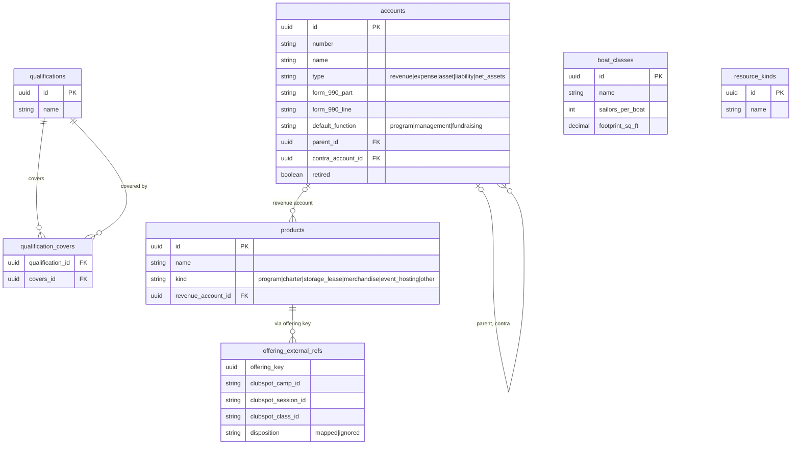
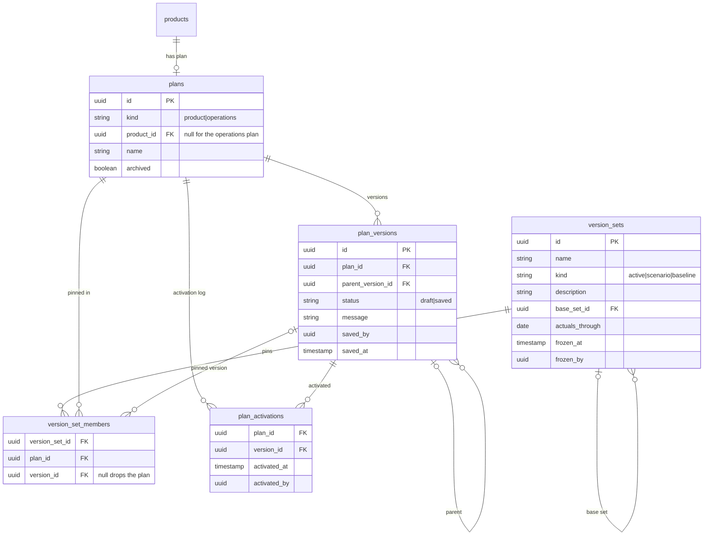
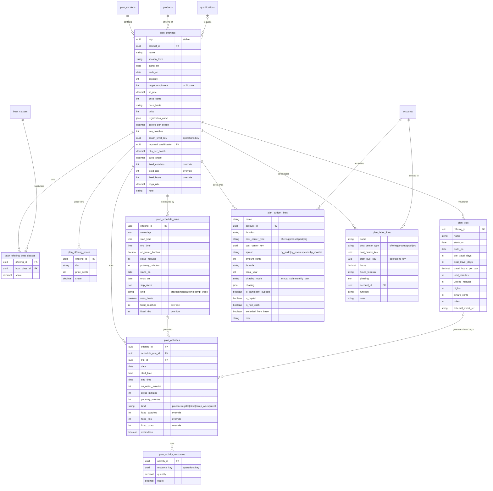
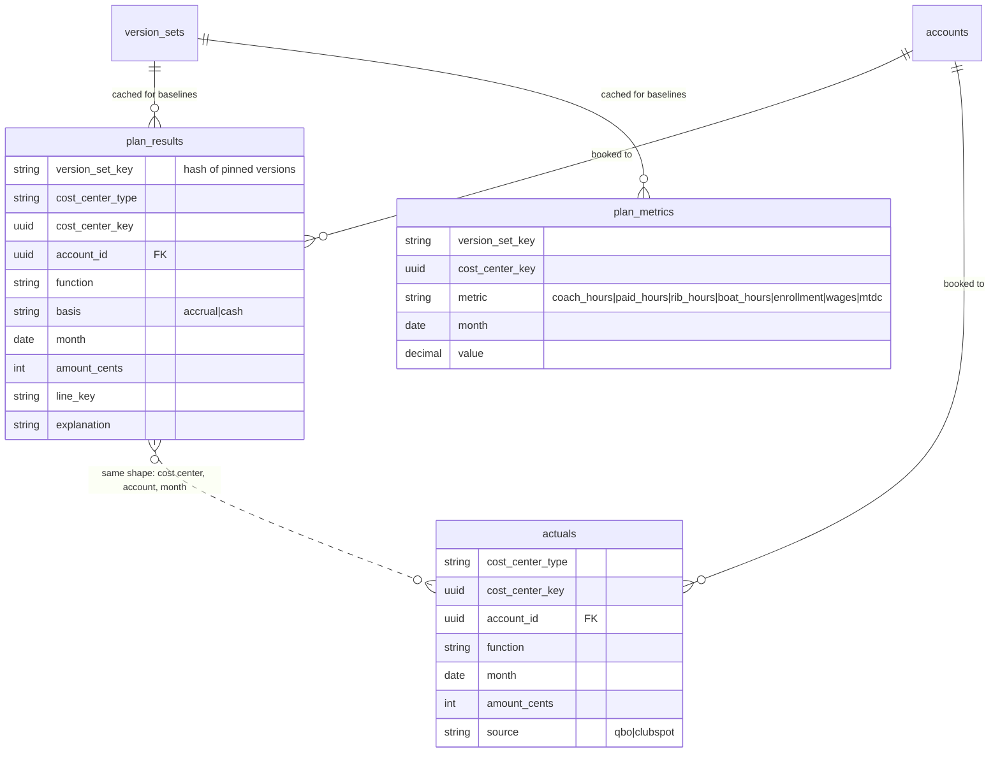

## Planning: schema

Entity-relationship diagrams for the program planning and financial model app. The app is proposed and not built yet, so no `schema.yaml` declares these collections. Update the diagrams in the same change as any change to the planning design or to its collections.

### Terms

- **Product:** a lasting thing CYC sells, such as J-Pod Race Team, boat charters or storage leasing. Products live in the new `core` domain.
- **Program:** a product of kind `program`, such as J-Pod Race Team. Each application groups programs its own way: the website by category, finance by revenue account, Google Workspace by Group. So no single program hierarchy exists.
- **Offering:** a product sold for a period, such as J-Pod Fall 2027 or Guppies summer week 3. A program offering is one Clubspot session × class, the unit Clubspot caps enrollment on.
- **Activity:** one dated, timed event that consumes resources, such as a practice or a regatta day.
- **Activity block:** activities from different offerings that share coaches and boats, set up by the planner. For example, J-Pod and K-Pod on Wednesdays.
- **Cost center:** what a money line belongs to. That is an offering, a product (spread over its offerings), a pool (G&A, program admin), or the org. Offerings that earn revenue are strictly profit centers, but one field covers every kind.
- **Bonus owner:** a role, such as Single-handed head coach. It owns a set of products and earns a bonus on their combined net.
- **Plan:** a separately versioned part of the plan. A **Program Plan** (or a Charter Plan, a Storage Plan and so on) holds one product's offerings. The **Operations Plan** holds what products share.
- **Version:** either a draft or an immutable saved snapshot of one plan.
- **Version set:** one version per plan.
  - The **active version set** is "the plan".
  - A **scenario** is a version set with some versions swapped, added or dropped.
  - A **baseline** is a frozen version set that variance is measured against.

### Diagram conventions

Every version-scoped entity also has an `id` (deterministic), a `version_id` and a `key`. The diagrams below leave these out except where they matter.

Arrays are shown as `json`.

Dashed lines are references by stable `key` across plans. The engine resolves them within a version set; they are not database foreign keys.

### `core` catalog

### Versioning

### Product plan (one version)

`spread` applies when the cost center is a product: it decides how the amount is pushed down to that product's offerings in the fiscal year. `plan_labor_lines` hold labor not tied to an activity, such as head-instructor weeks, training and boat-maintenance labor. They are priced at a staff level, and count toward the wages and paid-hours metrics.

### Operations plan (one version)

```mermaid
erDiagram
    plan_versions ||--o{ plan_assumptions : contains
    plan_versions ||--o{ plan_staff_levels : contains
    plan_versions ||--o{ plan_salaried_positions : contains
    plan_versions ||--o{ plan_resources : contains
    plan_versions ||--o{ plan_activity_block_rules : contains
    plan_versions ||--o{ plan_pools : contains
    plan_versions ||--o{ plan_formulas : contains
    plan_versions ||--o{ plan_bonus_owners : contains
    resource_kinds ||--o{ plan_resources : "kind of"
    boat_classes ||--o{ plan_boat_rates : "rate for"
    plan_salaried_positions ||--o{ plan_salaried_bookings : "management hours"
    products ||--o{ plan_salaried_bookings : "booked to"
    plan_staff_levels |o--o{ plan_activity_block_rules : "hourly level"
    plan_pools ||--o{ plan_pool_shares : shares
    plan_pools |o--o{ plan_pools : "remainder to"
    plan_formulas ||--o{ plan_formula_deps : "depends on"
    accounts ||--o{ plan_formulas : "booked to"
    plan_bonus_owners ||--o{ plan_bonus_owner_products : owns
    products ||--o{ plan_bonus_owner_products : "owned by"
    plan_activity_block_rules }o..o{ plan_offerings : "offering keys"
    plan_pool_shares }o..|| plan_offerings : "offering or product key"

    plan_assumptions {
        string name
        decimal value
        string unit
        date effective_from
        string note
    }
    plan_staff_levels {
        string name
        string pay_type "hourly|volunteer"
        int hourly_rate_cents
        json qualifications
        date effective_from
    }
    plan_salaried_positions {
        string name
        int annual_salary_cents
        int paid_hours_per_year
        json qualifications
        decimal ga_share
        uuid remainder_pool_id FK
        string form_990_line "override"
        date effective_from
        date effective_to
    }
    plan_salaried_bookings {
        uuid position_id FK
        uuid product_id FK
        date starts_on
        date ends_on
        string kind "management"
        decimal hours
    }
    plan_resources {
        uuid resource_kind_id FK
        string name
        int quantity
        int cost_per_hour_cents
        int cost_per_day_cents
        int fuel_per_hour_cents
        int maintenance_per_hour_cents
        date effective_from
    }
    plan_boat_rates {
        uuid boat_class_id FK
        int maintenance_per_boat_hour_cents
        date effective_from
    }
    plan_activity_block_rules {
        string name
        json offering_keys
        json weekdays
        date starts_on
        date ends_on
        uuid coach_level_id FK
        json salaried_positions
    }
    plan_pools {
        string name
        int step_order
        string method "base_share|fixed_shares|area|formula"
        string base
        json base_categories
        json targets_filter
        decimal denominator_quantity
        string unit
        uuid remainder_pool_id FK
        string phasing "by_base|even|target_months"
    }
    plan_pool_shares {
        uuid pool_id FK
        string target_type "offering|product"
        uuid target_key
        decimal share
        decimal quantity
        int amount_cents
        date starts_on
        date ends_on
    }
    plan_formulas {
        string name
        string dimension "none|offering|product|month"
        string expression
        uuid account_id FK
        string function
        string cost_center_type
        json applies_to_filter
        boolean excluded_from_base
        string note
    }
    plan_formula_deps {
        uuid formula_id FK
        string depends_on "formula, assumption or metric name"
    }
    plan_bonus_owners {
        string role_name
        decimal bonus_rate
        uuid account_id FK
        date starts_on
        date ends_on
    }
    plan_bonus_owner_products {
        uuid bonus_owner_id FK
        uuid product_id FK
    }
```

A bonus owner's bonus is `bonus_rate × max(0, the combined net of its products)`, so a loss on one owned product offsets gains on another. It is computed after every pool is allocated, and kept out of every base.

A pool's `remainder_pool_id` takes whatever its shares leave unclaimed. Unused storage, for example, flows into G&A before G&A is allocated. Pool shares carry dates, so summer can take 100% of the float in June to August while linear feet split it the rest of the year.

The Operations Plan also holds `plan_budget_lines` for org and pool lines (insurance, the clubhouse fee, fundraising, capital). They have the same shape as the product plan's lines.

### Results and actuals

